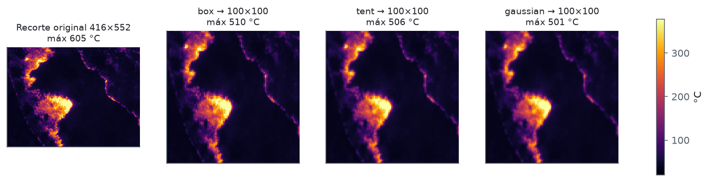
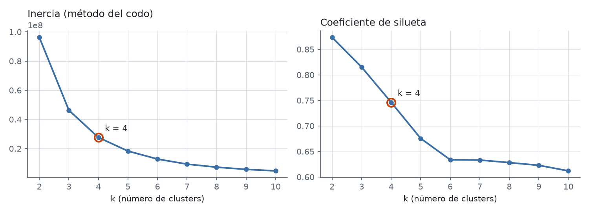
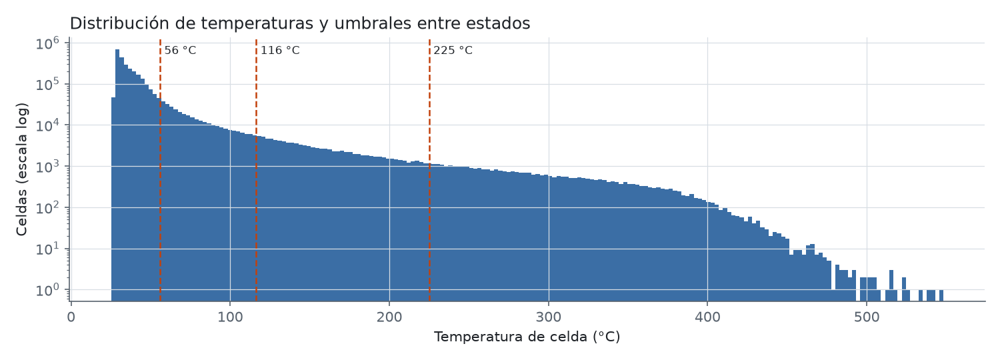
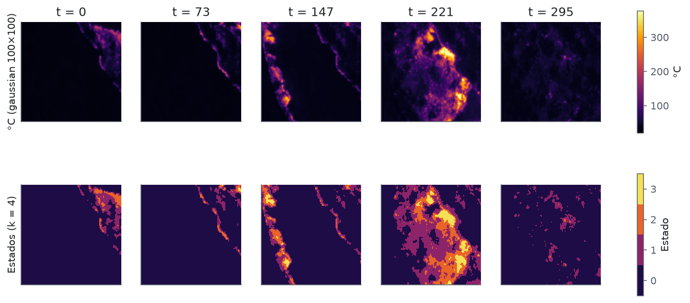
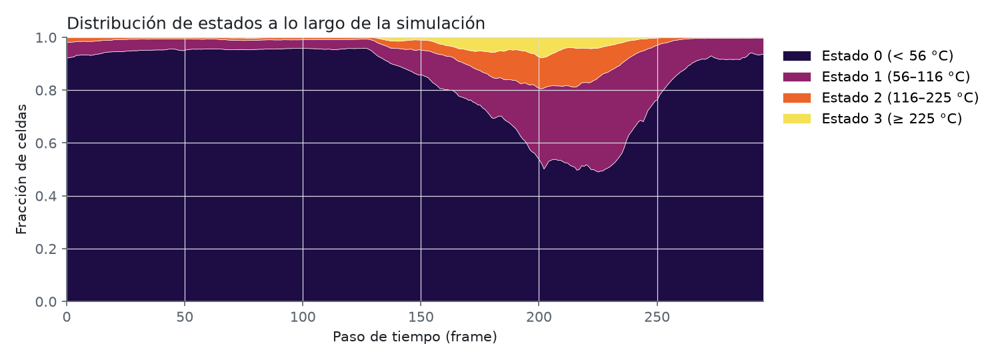
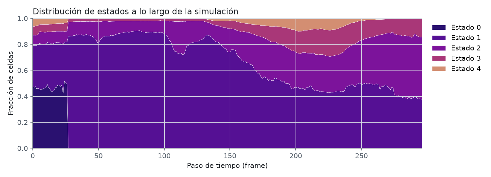
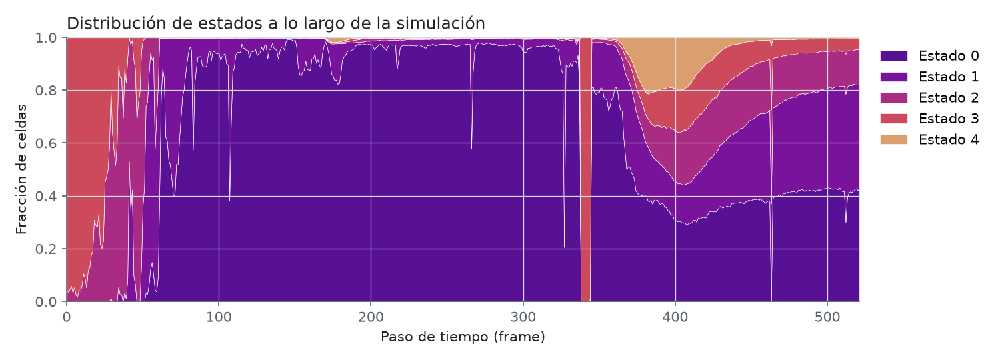

# Limpieza de imágenes térmicas → evolución del simulador

> Las secuencias de embriones se documentan en [`README_embryo.md`](README_embryo.md).

Convierte las secuencias térmicas en vista nadir del dataset **FLAME 3** en evoluciones
`(T, n, n) int32` que el simulador acepta como entrada (`.npy` / `.mat` con la variable
`evolution`, el mismo formato que produce `png_to_evolution.py`).

Hay dos procesos:

| Script | Entrada | Estado |
|---|---|---|
| [`celsius_to_evolution.py`](celsius_to_evolution.py) | GeoTIFF radiométricos en **°C** | **Recomendado.** Aplicado a plot 1 (§2–§3) |
| [`align_tiff.py`](align_tiff.py) | GeoTIFF radiométricos en **°C** | Estabiliza la secuencia antes de `celsius_to_evolution.py` (§2.1) |
| [`crop_square.py`](crop_square.py) | GeoTIFF alineados | Recorta el cuadrado válido más grande de todo el escenario (§2.1) |
| [`downsample_tiff.py`](downsample_tiff.py) | GeoTIFF cuadrados | Reduce a n×n con el kernel de §2.3 (§2.1) |
| [`cluster_states.py`](cluster_states.py) | GeoTIFF n×n | Número de estados por K-Means 1D y método del codo (§2.1) |
| [`render_states.py`](render_states.py) | GeoTIFF n×n | JPG ×10 de estados con 5 divisiones de temperatura, solo para comparar (§2.1) |
| [`tiff_to_states.py`](tiff_to_states.py) | GeoTIFF n×n | **Datos de entrenamiento**: estados con cortes logarítmicos comunes (§2.1) |
| [`thermal_to_evolution.py`](thermal_to_evolution.py) | JPG en pseudocolor | Primera versión; afectado por el AGC de la cámara (§4) |

## 1. Datos de origen

| | |
|---|---|
| Dataset | [FLAME 3 – Nadir Thermal Plot Subset](https://www.kaggle.com/datasets/brycehopkins/flame-3-nadir-thermal-plot-subset) (`extract_data.py`) |
| Sitio | Hanna Hammock, quema prescrita del 2023-02-28 |
| Cámara | Autel Robotics XT709 (dron), 640×512 |
| Copias locales | `Dataset/<escenario>/raw_thermal_jpg` y `Dataset/<escenario>/geo_thermal_tiff_celsius`, con `flame_plot_1` (plot 1, `IRX_0533`–`0824`), `flame_plot_2` (plot 2 parte 1, `IRX_0825`–`1147`) y `flame_plot_3` (plot 2 parte 2, `IRX_1170`–`1346`); se descargan con `extract_data.py` |

| Escenario | JPG | GeoTIFF °C | Inicio → fin | Δt mediana | Huecos > 10 s |
|---|---|---|---|---|---|
| plot 1 | 297 (`IRX_0528`–`0824`) | 296 (`IRX_0529`–`0824`) | 11:46:19 → 12:11:32 (25 min) | 5 s | 15 s y 26 s al inicio |
| plot 2 | 522 (`IRX_0825`–`1346`) | 498 (en dos partes) | 12:41:27 → 13:32:29 (51 min) | 5 s | **460 s** en t 344→345 |
| plot 3 | — | — | — | — | sin imágenes térmicas (solo `raw_jpg_rgb`) |

El orden por nombre de archivo coincide con el orden temporal EXIF y no hay huecos en la
numeración. Los GeoTIFF no traen fecha; se toma del JPG con el mismo número `IRX_XXXX`.

## 2. Proceso con GeoTIFF en °C (`celsius_to_evolution.py`)

### 2.1 Lectura y alineación

Cada `IRX_XXXX_ref_geo.TIFF` es un raster `float32` de 654×531 en **°C absolutos**,
georreferenciado en EPSG:26916 (UTM 16N) con resolución de 0.153 m × 0.162 m por píxel.
**Todos los frames comparten exactamente la misma malla** (mismo `transform`), así que el
movimiento del dron está corregido en gran parte. Aun así queda una deriva residual que se mide
con `align_tiff.py`: hasta 8.6 px en `flame_plot_1`, 5.3 px en `flame_plot_2` y 9.3 px en
`flame_plot_3` (≈ 1–2 celdas en 100×100). `celsius_to_evolution.py` verifica que todos los frames
compartan la malla y se detiene si alguno no coincide.

`align_tiff.py Dataset/<escenario>` mide la traslación subpíxel entre pares de frames a
distancias 1, 2, 4, …, 128 (correlación de fase sobre la textura del suelo frío, < 50 °C, con
12 px de margen alrededor del fuego; más pares a distancia 1, 2 y 4 sobre log(°C) con peso bajo
para los frames que el fuego cubre casi por completo) y resuelve la posición de todos los frames
por mínimos cuadrados robustos (Huber), con el primero fijo. Encadenar solo frames consecutivos
acumulaba hasta 5 px de error en plot 2; con este ajuste la posición coincide a < 0.2 px con la
medida directa contra el primer frame. Escribe `geo_thermal_tiff_celsius_aligned/`,
`raw_thermal_jpg_aligned/` (pseudocolor inferno con escala logarítmica fija, para revisión
visual) y `shifts.csv` (corrección aplicada a cada frame, en px).

`crop_square.py Dataset/<escenario>` toma el cuadrado más grande con dato en **todos** los
frames alineados (programación dinámica; entre empates, el más cercano al centro de la zona
válida) y escribe `geo_thermal_tiff_celsius_aligned_<lado>/` (transform ajustado) y
`raw_thermal_jpg_aligned_<lado>/`:

| Escenario | Cuadrado | Filas | Columnas | Píxeles > 100 °C que conserva | Frames con fuego |
|---|---|---|---|---|---|
| `flame_plot_1` | 416×416 | 79:495 | 119:535 | 87 % | 100 % |
| `flame_plot_2` | 477×477 | 32:509 | 149:626 | 58 % | 69 % |
| `flame_plot_3` | 496×496 | 16:512 | 118:614 | 86 % | 100 % |

`downsample_tiff.py Dataset/<escenario>` reduce el cuadrado a `--size` × `--size` (100 por
default) con el kernel gaussiano de §2.3 y escribe `geo_thermal_tiff_celsius_aligned_<n>/`
(transform escalado, misma extensión en el terreno) y `raw_thermal_jpg_aligned_<n>/`. En 100×100
cada celda junta 4.16, 4.77 y 4.96 px (plots 1, 2 y 3) y la temperatura media no cambia.
Con `--zoom 10` escribe además `raw_thermal_jpg_aligned_<n>_x10/`: los mismos JPG ampliados 10 veces
por vecino más cercano (1000×1000, cada celda un bloque de 10×10 px), solo para revisión visual.

`cluster_states.py Dataset/<escenario>` aplica el procedimiento de §2.4 a los GeoTIFF 100×100
de todo el escenario (muestra de 200 000 valores, k = 2 … 10, codo por Kneedle) y guarda
`clusters_100.png` (codo con el k elegido marcado y silueta) y `clusters_100.json` (curva, k,
centroides, umbrales y fracción de celdas por estado):

| Escenario | k | Centroides (°C) | Umbrales (°C) | Celdas por estado |
|---|---|---|---|---|
| `flame_plot_1` | 4 | 36.4, 82.2, 168.9, 306.8 | 59.3, 125.6, 237.9 | 83.3, 11.4, 3.9, 1.5 % |
| `flame_plot_2` | 4 | 29.7, 91.4, 184.1, 353.5 | 60.5, 137.7, 268.8 | 99.3, 0.5, 0.2, 0.04 % |
| `flame_plot_3` | 4 | 48.2, 108.6, 211.0, 365.7 | 78.4, 159.8, 288.4 | 65.8, 21.0, 8.9, 4.3 % |

Con `--k 10` se fija k (el codo se sigue reportando) y se escribe `clusters_100_k10.png/.json`:

| Escenario | Umbrales (°C) con k = 10 | Celdas por estado (%) |
|---|---|---|
| `flame_plot_1` | 36.2, 47.8, 64.7, 88.5, 119.1, 157.6, 205.2, 262.7, 332.0 | 50.0, 24.4, 11.1, 5.4, 3.3, 2.2, 1.5, 1.0, 0.7, 0.4 |
| `flame_plot_2` | 30.0, 38.8, 60.4, 91.0, 128.0, 173.4, 227.7, 295.7, 383.2 | 71.6, 27.1, 0.6, 0.3, 0.2, 0.1, 0.06, 0.03, 0.02, 0.01 |
| `flame_plot_3` | 45.2, 65.4, 91.1, 124.1, 165.1, 215.2, 274.0, 340.3, 414.7 | 31.0, 25.3, 15.6, 9.2, 6.3, 4.5, 3.2, 2.3, 1.8, 0.9 |

`render_states.py Dataset/<escenario> … --k K` escribe en cada escenario
`raw_thermal_jpg_aligned_100_x10_<método><K>/` (estados en paleta turbo discreta, frío → caliente,
más `_leyenda.png` con el rango de °C de cada estado) para comparar cuatro divisiones: `kmeans`
(umbrales de `cluster_states.py --k K`, propios de cada escenario) y, con el mínimo y máximo de los
escenarios dados, `ancho` (mismo ancho en °C), `cuantil` (mismo número de celdas) y `log` (mismo ancho
en log °C). Con K = 15 en `flame_plot_3` (22.3–604.6 °C):

| Método | Cortes (°C) | Celdas por estado (%) |
|---|---|---|
| `kmeans15` | 39, 53, 67, 85, 105, 129, 155, 184, 217, 254, 295, 340, 390, 451 | 20.5, 21.7, 15.8, 11.1, 7.5, 5.4, 4.2, 3.3, 2.6, 2.1, 1.7, 1.5, 1.3, 1.0, 0.3 |
| `ancho15` | 61, 100, 139, 178, 216, 255, 294, 333, 372, 411, 449, 488, 527, 566 | 52.2, 22.7, 8.9, 5.0, 3.2, 2.2, 1.6, 1.3, 1.0, 0.9, 0.6, 0.2, 0.1, 0.0, 0.0 |
| `cuantil15` | 31, 36, 39, 43, 47, 51, 56, 62, 70, 80, 95, 119, 159, 238 | 6.7 cada uno |
| `log15` | 28, 35, 43, 54, 67, 83, 104, 130, 161, 201, 251, 312, 389, 485 | 2.0, 9.8, 15.5, 16.5, 13.9, 10.8, 7.7, 6.0, 4.8, 3.9, 3.1, 2.5, 2.1, 1.3, 0.1 |

Se eligió `log15`. `tiff_to_states.py Dataset/flame_plot_1 Dataset/flame_plot_2 Dataset/flame_plot_3`
toma 15 cortes iguales en log(°C) entre el mínimo y el máximo de los tres escenarios (22.26 y
604.60 °C, factor 1.246 entre cortes: 27.7, 34.6, 43.1, 53.7, 66.9, 83.4, 103.9, 129.5, 161.4,
201.1, 250.7, 312.4, 389.3 y 485.1 °C) y escribe en `CA/FLAME3/<escenario>/`, con la misma
estructura que el resto de `CA/`: `evo.npy` / `evo.mat` (variable `evolution`, int32 T×100×100),
`evo_celsius.npy`, `evo.json` (metadatos, rango de °C de cada estado, Δt = 5 s), `evo.gif` y
`evo_final.png`. También escribe la paleta de la GUI `GUI/colores/flame_log15.csv` (turbo en 15
pasos, los mismos colores que los JPG de `render_states.py`).

| Escenario | Shape | Celdas por estado (%) | Celdas en estado 14 | Huecos > 10 s |
|---|---|---|---|---|
| `flame_plot_1` | 292×100×100 | 1.1, 44.2, 21.5, 13.2, 6.2, 3.8, 2.7, 2.1, 1.6, 1.2, 0.9, 0.7, 0.5, 0.1, 0.002 | 48 | 26 s entre `IRX_0554` y `0555` |
| `flame_plot_2` | 322×100×100 | 2.4, 95.8, 0.9, 0.3, 0.2, 0.1, 0.1, 0.1, 0.1, 0.1, 0.04, 0.02, 0.02, 0.01, 0.0004 | 13 | — |
| `flame_plot_3` | 176×100×100 | 2.0, 9.8, 15.5, 16.5, 13.9, 10.8, 7.7, 6.0, 4.8, 3.9, 3.1, 2.5, 2.1, 1.3, 0.1 | 2 152 | — |

### 2.2 Recorte de la región válida

Al reproyectar, las zonas que la cámara no vio quedan en **0 °C** (sin dato). La huella de
cada frame es distinta, por lo que se calcula la máscara de píxeles con dato en **todos**
los frames y se toma el **rectángulo alineado a los ejes de mayor área** dentro de ella
(algoritmo del histograma por filas, O(H·W)).

Plot 1: filas 74:490, columnas 53:605 → **416×552 px ≈ 67.5 m × 84.3 m**.

### 2.3 Reducción a n×n con kernels de convolución

Cada frame `X` (416×552) se convoluciona con un kernel 2D separable y se muestrea en una
malla de n×n centros equiespaciados. Al ser separable se escribe como dos matrices:

```
Y_t = K_r · X_t · K_cᵀ        K_r ∈ ℝ^{n×416},  K_c ∈ ℝ^{n×552}
```

La fila i de `K` es el kernel centrado en `c_i = (i + ½)·s − ½`, con paso `s = L / n`
(4.16 en filas, 5.52 en columnas), normalizado para sumar 1. Así una celda de 100×100
representa ≈ 0.84 m × 0.68 m del terreno. Kernels disponibles (`--kernel`):

| Kernel | Peso `w(d)` (d = distancia al centro en px) | Soporte |
|---|---|---|
| `box` | traslape del píxel con la ventana `[c − s/2, c + s/2]` (promedio por área) | s |
| `tent` | `max(0, 1 − |d|/s)` (triangular) | 2s |
| `gaussian` (default) | `exp(−d² / 2σ²)`, σ = s/2 | 6σ = 3s |

Se usa el **gaussiano** por ser el filtro paso-bajas sin *ringing* que mejor evita el
*aliasing* al reducir resolución. Los tres conservan la temperatura media; difieren en
cuánto suavizan los picos (toda la simulación de plot 1):

| | Original 416×552 | box | tent | gaussian |
|---|---|---|---|---|
| Máximo (°C) | 604.6 | 573.5 | 558.6 | 548.2 |
| Percentil 99.9 (°C) | 392.6 | 384.1 | 380.1 | 377.3 |
| Mediana (°C) | 35.5 | 35.6 | 35.7 | 35.8 |



### 2.4 Número de clusters de temperatura

Se agrupan las temperaturas de **todas** las celdas de **todos** los frames (296 × 100 × 100
= 2.96 M valores), de modo que el estado *i* corresponde al mismo rango de °C en todo
momento:

1. Se muestrean 200 000 celdas (semilla 0).
2. Para k = 2 … 10 se ajusta K-Means 1D sobre °C (`n_init=4`) y se registran la
   **inercia** y el **coeficiente de silueta** (10 000 celdas).
3. k se elige con el **método del codo** (criterio *Kneedle*: mayor distancia de la curva
   normalizada a la recta entre sus extremos).
4. La silueta decrece monótonamente (máximo en k = 2, que solo separa "fuego / no fuego"),
   así que se usa como verificación y no como criterio.
5. Se reajusta con el k elegido (`n_init=10`).

Se agrupa en °C lineales: en escala logarítmica K-Means gastaba dos clusters en partir el
suelo a temperatura ambiente (31 °C vs 42 °C) y perdía resolución en el fuego.

### 2.5 Conversión a estados

En 1D, asignar el centroide más cercano equivale a cortar en los **puntos medios** entre
centroides ordenados. Esos umbrales definen los estados (0 = más frío) y se aplican con
`np.digitize` a las temperaturas `n×n`.

## 3. Resultados — plot 1 (°C, gaussian, n = 100)

```bash
cd Simulator/training
../GUI/venv/bin/python preprocessing/celsius_to_evolution.py Dataset/plot_1/geo_thermal_tiff_celsius CA/FLAME3/flame3_plot1_celsius_100
```

**`CA/FLAME3/flame3_plot1_celsius_100.npy` — shape `(296, 100, 100)`, k = 4**

| k | 2 | 3 | **4** | 5 | 6 | 7 | 8 | 9 | 10 |
|---|---|---|---|---|---|---|---|---|---|
| Inercia (×10⁷) | 9.63 | 4.63 | **2.76** | 1.83 | 1.28 | 0.93 | 0.73 | 0.58 | 0.47 |
| Silueta | 0.874 | 0.815 | **0.746** | 0.676 | 0.634 | 0.633 | 0.628 | 0.623 | 0.612 |



| Estado | Centroide | Rango | Fracción | Interpretación |
|---|---|---|---|---|
| 0 | 35.8 °C | < 56 °C | 83.7 % | Suelo / vegetación sin quemar o ya fría |
| 1 | 76.1 °C | 56 – 116 °C | 11.4 % | Zona caliente: precalentamiento o rescoldo |
| 2 | 156.7 °C | 116 – 225 °C | 3.6 % | Combustión latente |
| 3 | 293.5 °C | ≥ 225 °C | 1.3 % | Frente de llama |





La proporción de estados evoluciona de forma suave: el frente cruza el encuadre, la quema
alcanza su máximo alrededor de t ≈ 200–230 (≈ 50 % de celdas en estados 1–3) y después
la zona se enfría. No aparecen los saltos de un frame que produce el AGC en los JPG.

### Opciones

| Opción | Default | Descripción |
|---|---|---|
| `--size` | 100 | Lado n de la malla |
| `--kernel` | `gaussian` | `box`, `tent` o `gaussian` |
| `--nodata` | 0 | Valores ≤ a este se consideran sin dato |
| `--k` | — | Número de clusters; si se omite se elige con el codo |
| `--k-min`, `--k-max` | 2, 10 | Rango de k evaluado |
| `--sample` | 200000 | Celdas para ajustar K-Means |
| `--sil-size` | 10000 | Celdas para la silueta |
| `--seed` | 0 | Semilla |
| `--jpg-dir` | `../raw_thermal_jpg` | JPG de donde leer los timestamps |
| `--fig-dir` | `preprocessing/docs/thermal` | Carpeta de figuras |

Dependencias (en `GUI/venv`): `numpy`, `scipy`, `pillow`, `scikit-learn`, `matplotlib`, `rasterio`.

### Salidas

| Archivo | Contenido |
|---|---|
| `CA/FLAME3/<nombre>.npy` | Estados `(T, n, n) int32` — entrada del simulador |
| `CA/FLAME3/<nombre>.mat` | Lo mismo, variable `evolution` |
| `CA/FLAME3/<nombre>_celsius.npy` | Temperaturas `(T, n, n) float32` después del kernel, antes de agrupar |
| `CA/FLAME3/<nombre>.json` | Archivos, timestamps, recorte, kernel, centroides, umbrales, fracciones y curvas de k |
| `docs/thermal/<nombre>_k.png` | Codo y silueta |
| `docs/thermal/<nombre>_kernels.png` | Comparación de kernels en el frame más caliente |
| `docs/thermal/<nombre>_hist.png` | Histograma de °C con los umbrales |
| `docs/thermal/<nombre>_frames.png` | °C vs. estados en 5 momentos |
| `docs/thermal/<nombre>_states.png` | Fracción de cada estado en el tiempo |

`Dataset/` y `CA/FLAME3/` están en `.gitignore`; las figuras de `preprocessing/docs/thermal/` sí se versionan.

---

## 4. Proceso con JPG en pseudocolor (`thermal_to_evolution.py`, primera versión)

```bash
../GUI/venv/bin/python preprocessing/thermal_to_evolution.py Dataset/plot_1/raw_thermal_jpg CA/FLAME3/flame3_plot1_100
../GUI/venv/bin/python preprocessing/thermal_to_evolution.py Dataset/plot_2/raw_thermal_jpg CA/FLAME3/flame3_plot2_100  # plot_2 completo, antes de dividirlo en 2a y 2b
```

1. **Escalado:** cada JPG de 640×512 se lleva a 100×100 estirando, con `PIL` y filtro BOX
   (promedio por área).
2. **Clusters:** K-Means sobre los colores RGB de todos los píxeles de la simulación
   (200 000 muestreados), k = 2…10, codo + silueta, igual que en §2.4.
3. **Estados:** clusters ordenados por luminancia del centroide
   (0.299 R + 0.587 G + 0.114 B); la paleta va de morado (frío) a amarillo/blanco (caliente).

Opciones: `--size`, `--k`, `--k-min`, `--k-max`, `--sample`, `--sil-size`, `--seed`,
`--fig-dir`. Salidas: `.npy`, `.mat`, `.json` y figuras `_k`, `_palette`, `_frames`, `_states`.

### Resultados

| Escenario | Salida | Shape | k (codo) | Estados (centroide, fracción) |
|---|---|---|---|---|
| plot 1 | `CA/FLAME3/flame3_plot1_100` | (297, 100, 100) | 5 | `#2a1170` 4.3 %, `#551094` 62.8 %, `#7c139b` 21.9 %, `#a93778` 8.2 %, `#d38e72` 2.8 % |
| plot 2 | `CA/FLAME3/flame3_plot2_100` | (522, 100, 100) | 5 | `#581095` 63.4 %, `#7a139b` 15.1 %, `#aa2b83` 9.7 %, `#cd4a5d` 9.6 %, `#da9e6f` 2.2 % |




### Limitación: la paleta de los JPG no es absoluta

La cámara aplica control automático de ganancia (AGC): estira la paleta entre la
temperatura mínima y máxima *de cada frame*, así que un mismo color no corresponde a la
misma temperatura en frames distintos. Efectos observados:

- **plot 2, t = 0…60:** sin fuego en el encuadre, el suelo aparece naranja (estados 2–3);
  en t = 61 entra el frente y el mismo suelo pasa a morado (estado 0).
- **plot 2, t = 338…344:** frames casi uniformes en naranja seguidos del hueco de 460 s.
- **plot 2, t ≈ 463** y **plot 1, t = 0…26:** saltos de un frame por reajustes de paleta.
- Los JPG no están georreferenciados: el encuadre se desplaza con el dron.

El proceso con GeoTIFF en °C (§2) elimina los tres problemas: temperaturas absolutas,
malla común y recorte a la región observada en todos los frames.
