# Segmentación de embriones → evolución del simulador

Convierte las secuencias time-lapse de desarrollo embrionario en evoluciones
`(T, n, n) int32` que el simulador acepta como entrada (`.npy` / `.mat` con la variable
`evolution`, el mismo formato que produce `png_to_evolution.py` y `celsius_to_evolution.py`).

| Script | Entrada | Estado |
|---|---|---|
| [`embryo_to_evolution.py`](embryo_to_evolution.py) | JPEG en escala de grises, una carpeta por embrión | Aplicado a AA83-7, AG782-8 y BV646-6 (§3) |

## 1. Datos de origen

| | |
|---|---|
| Dataset | Time-lapse embryo dataset (Gomez et al., 2022), plano focal central |
| Contenido | Embriones humanos en incubadora time-lapse, del cigoto a mórula/blastocisto |
| Imagen | JPEG 500×500, escala de grises, 1 canal |
| Copia local | `CA/embryo/<id>/` (13 GB, en `.gitignore`) |

| | Valor |
|---|---|
| Embriones | 704 carpetas (`AA83-7`, `AG782-8`, …) |
| Imágenes | 342 363 únicas |
| Frames por embrión | mín 137 · p25 436 · mediana 548 · p75 559 · máx 1140 (GE218-3) |
| Nombre de archivo | `D<fecha>_S<sesión>_I132_WELL<pozo>_RUN<n>.jpeg` |

Detalles del dataset que el script toma en cuenta:

- **`n` no tiene ceros a la izquierda** (`RUN9`, `RUN10`, …): el orden alfabético no es el
  temporal. Se ordena por el valor numérico de `n`.
- **Copias en `F0/`:** 211 embriones repiten todas sus imágenes dentro de una subcarpeta
  `F0/`. Las 101 194 copias son idénticas byte a byte a las de la raíz; se toma una sola por
  número de RUN.
- **Huecos:** en 215 embriones faltan 1 o 2 números de RUN (184 con 1, 31 con 2). El script
  concatena los frames existentes, así que en esos puntos el paso de tiempo es doble o triple.
- **Sin fecha por frame:** los JPEG no traen EXIF; solo se conoce el orden.
- **Frames sin embrión:** al final de algunas secuencias el embrión sale de cuadro y la
  imagen queda lisa (AG782-8: frames 374–564).

## 2. Proceso (`embryo_to_evolution.py`)

Cada imagen muestra el pozo de cultivo (un anillo brillante grande), la **zona pelúcida**
(un anillo gris de ~20 px con textura fina) y, dentro de ella, las células. Los estados se
definen por geometría (fuera / zona / interior) y, dentro de la zona, por bordes y brillo.

### 2.1 Localización de la zona pelúcida

El círculo se calcula **una vez por embrión** y es el mismo para todos sus frames. Si se
detectara frame a frame, el ruido de la detección (2–3 px) se convertiría en un zoom falso
que el NCA vería como expansión o contracción.

En un frame aislado el borde exterior de la zona es una transición suave y tenue. Se
probaron Hough sobre Canny (encuentra la célula o el pozo, no la zona), un mapa de textura
local (se extiende hasta el pozo) y un Hough con signo del gradiente radial (atraído por la
pared del pozo); ninguno fue estable. Lo que sí funciona es usar **toda la secuencia**:

1. **Círculo interior `r_in`.** La zona no se mueve y las células sí, así que la
   **desviación estándar temporal** por píxel dibuja el interior de la zona como un disco
   brillante y nítido (abajo, columna derecha). Se suaviza (σ = 3), se umbraliza con Otsu,
   se toma la componente más grande que no toca el borde de la imagen, se cierran huecos y
   se ajusta un círculo a su contorno con **RANSAC** (`CircleModel`, residuo 3 px).
2. **Círculo exterior `R`.** En la **imagen media** se calcula la textura fina
   `|I − G₂ * I|` y su perfil radial desde el centro. `R` es la mayor caída de ese perfil
   entre `r_in + 10` y `r_in + 35` px: donde termina la textura de la zona.

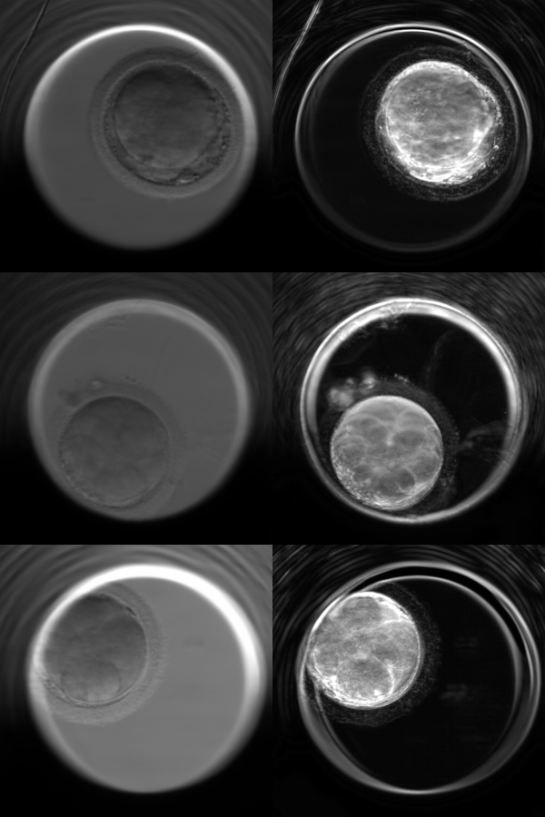

*Media temporal (izquierda) y desviación estándar temporal (derecha) de AA83-7, AG782-8 y
BV646-6.*

### 2.2 Frames inválidos

Con el círculo de la primera pasada se mide la textura media `|I − G₂ * I|` dentro de
`r_in` en cada frame. Un frame es inválido si su textura es menor que 0.3 × el percentil 90
de la secuencia (en AG782-8 cae de 0.026 a 0.002 cuando el embrión sale de cuadro). Se
conserva el **tramo continuo más largo** de frames válidos, para que el paso de tiempo no
tenga saltos, y se recalcula el círculo solo con esos frames.

### 2.3 Recorte y reducción a n×n

Se recorta el cuadrado de lado `2R` centrado en el círculo (si sale de la imagen se rellena
con el valor del borde) y se reduce a n×n con el kernel `box` de `celsius_to_evolution.py`
(promedio por área). Así cada embrión queda normalizado al tamaño de su zona pelúcida:
con n = 100, una celda equivale a ~2.7 px originales y el anillo de la zona mide ~8 celdas.

### 2.4 Estados

| Estado | Color | Regla |
|---|---|---|
| 0 | negro | Fuera del círculo exterior (`r > R`) |
| 1 | azul | Zona pelúcida (`r_in < r ≤ R`) |
| 2 | verde | Interior que no cumple 3 ni 4 |
| 3 | amarillo | **Borde**: Sobel del frame n×n con histéresis + mediana temporal |
| 4 | rosa | **Brillo**: intensidad > media + 1.5·σ del interior, en celdas que no son borde |

`r` es la distancia del centro de cada celda al centro del círculo, en px originales.

**Borde (estado 3).** Sobre el frame ya reducido a n×n:

1. Magnitud del gradiente con Sobel.
2. Umbral de Otsu `θ` calculado con **todas** las celdas interiores de **todos** los frames
   del embrión. Un umbral por frame cambiaría el significado del estado 3 en cada paso.
3. Histéresis: una celda con gradiente > `θ` es borde solo si está conectada a una celda con
   gradiente > 1.5·`θ`. Quita los puntos y rayas sueltos sin adelgazar las membranas.
4. Mediana temporal de 3 frames por celda: quita el parpadeo de bordes entre frames.
5. No se marcan bordes a menos de 4 px originales de la zona, para que la frontera entre la
   zona y el interior no aparezca como un anillo fijo de estado 3.

**Brillo (estado 4).** En esta microscopía el lado claro de cada membrana es brillante, así
que el estado 4 aparece pegado a los bordes y les da grosor y estructura en vez de dejar
solo líneas. El umbral (media + 1.5·σ del interior) también es fijo por embrión.

### 2.5 Pruebas que llevaron a estas reglas

Todas sobre los mismos frames de AA83-7 (RUN1, cigoto; RUN143, 2 células).

**Detector de bordes.** Canny a 500 px (σ = 2 y σ = 3), Canny a 100×100 y Sobel + Otsu a
100×100, más la variante con brillo. Con umbrales por percentil Canny marcaba el grano del
citoplasma como borde; con Otsu las cuatro aíslan las membranas. Se eligió **Sobel + Otsu +
brillo (E)** porque el brillo añade estructura a los bordes.

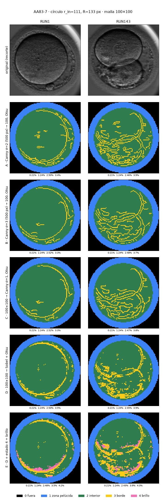

**Reducción de ruido.** La apertura morfológica (erosión y dilatación, ×1 y ×2) borra las
membranas, que miden 1–2 celdas de grosor: en AG782-8 t = 186 el borde baja de 10.5 % a
0.0 %. Un filtro por área casi no cambia nada porque el ruido está pegado a las membranas.

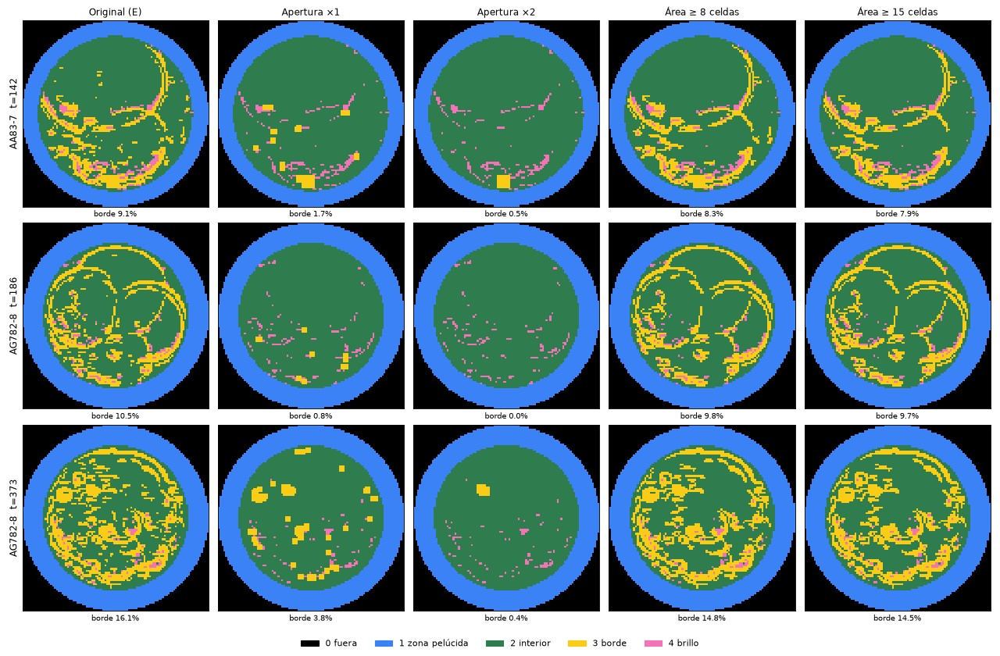

La histéresis es la que mejor limpia sin perder membranas; la mediana temporal estabiliza la
animación.

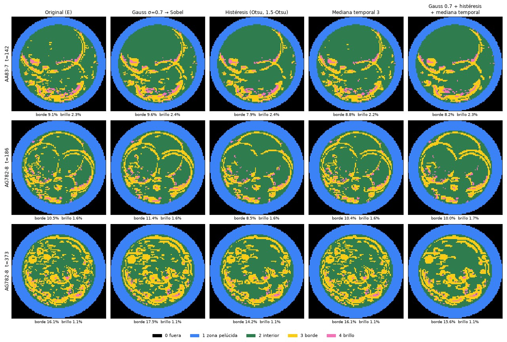

## 3. Resultados (n = 100)

```bash
cd Simulator/training
../GUI/venv/bin/python preprocessing/embryo_to_evolution.py CA/embryo/AA83-7 CA/embryo/AG782-8 CA/embryo/BV646-6 --gif
```

| Embrión | Frames usados | Centro (px) | `r_in` / `R` (px) | 0 | 1 | 2 | 3 | 4 |
|---|---|---|---|---|---|---|---|---|
| AA83-7 | 285 de 285 | (311.7, 230.0) | 110.8 / 133 | 21.4 % | 24.0 % | 44.9 % | 7.4 % | 2.3 % |
| AG782-8 | **374 de 565** | (210.2, 328.0) | 105.5 / 135 | 21.4 % | 30.6 % | 38.4 % | 8.0 % | 1.6 % |
| BV646-6 | 154 de 154 | (167.9, 193.8) | 108.6 / 141 | 21.4 % | 32.0 % | 37.1 % | 7.5 % | 2.0 % |

El estado 0 siempre ocupa 21.4 %: es el área fuera del círculo inscrito en el cuadrado
(1 − π/4).

**AA83-7**: del cigoto a 8 células.

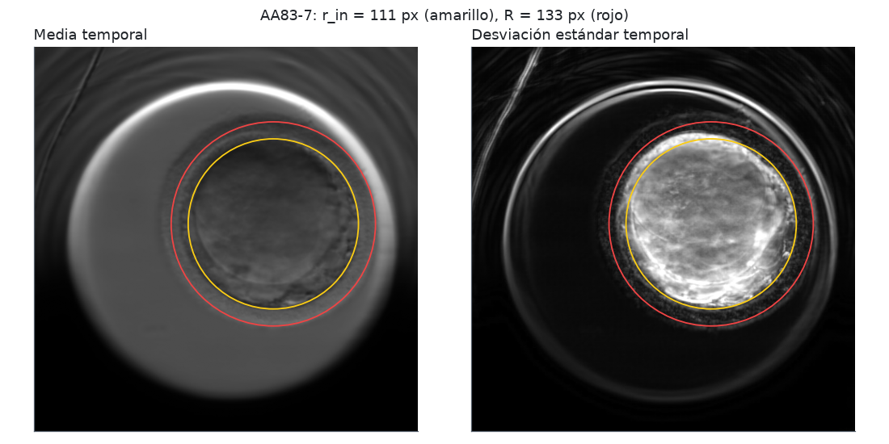
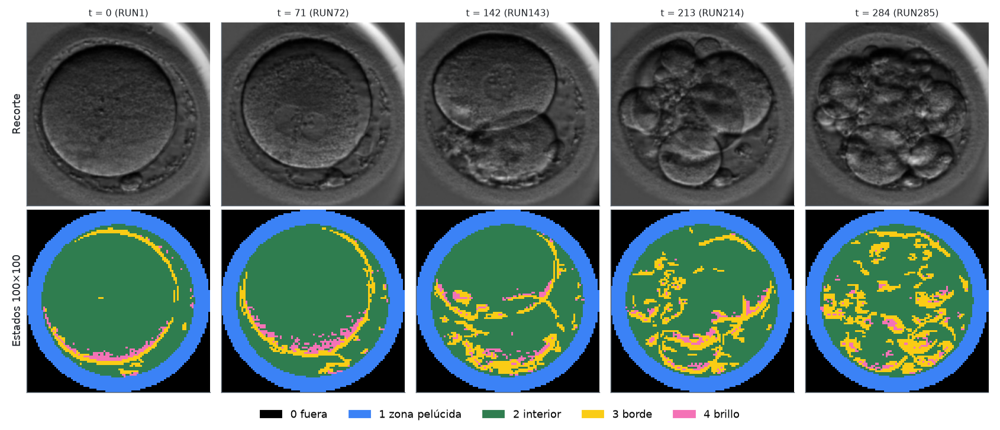
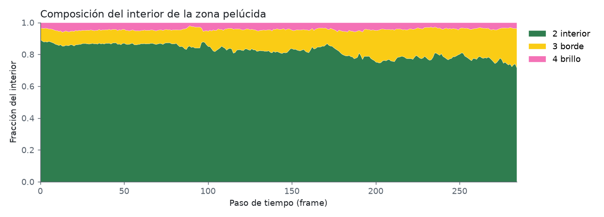

**AG782-8**: del cigoto a mórula; se descartaron los últimos 191 frames (embrión fuera de
cuadro).

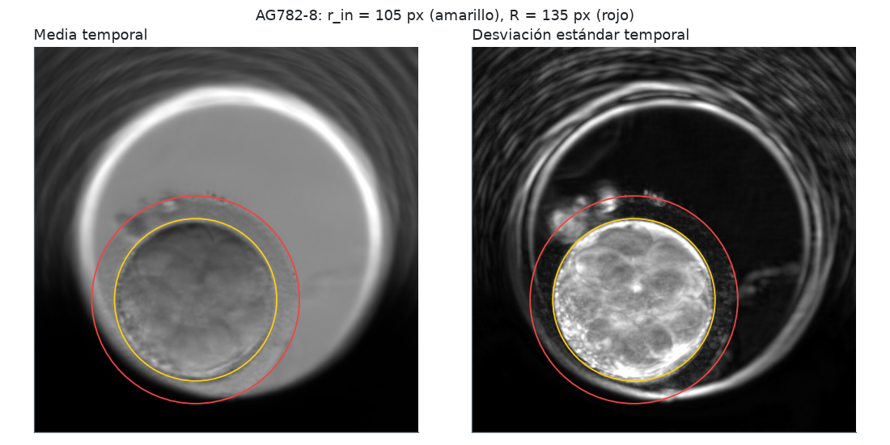
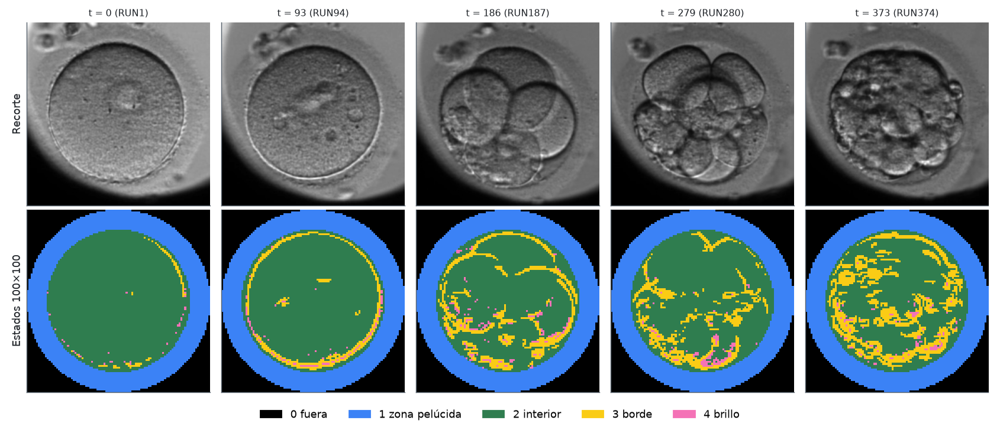
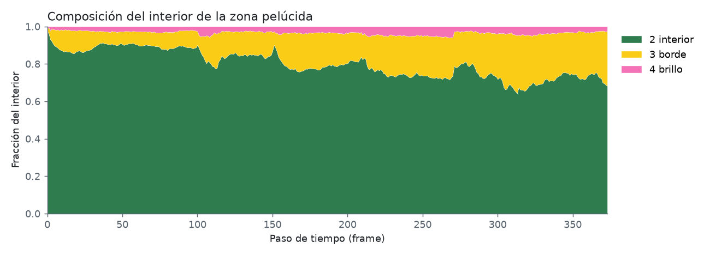

**BV646-6**: el embrión está pegado a la pared del pozo (ver §4).

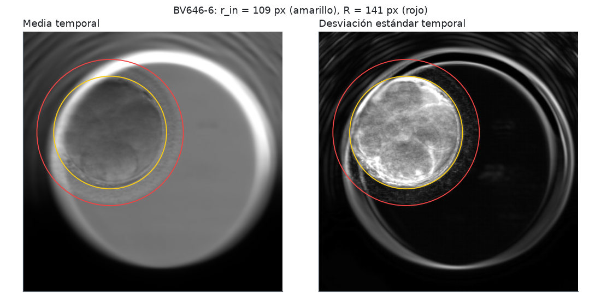
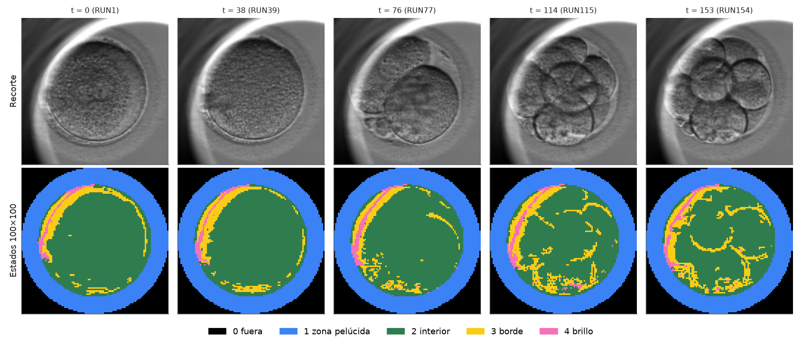
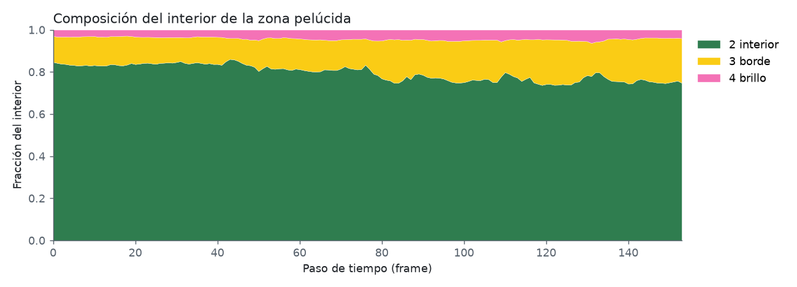

La fracción de borde dentro del embrión (estado 3 sobre estados 2–4) crece con el número
de células. Promedio de los primeros y últimos 10 frames:

| Embrión | Inicio | Final |
|---|---|---|
| AA83-7 | 8.2 % | 22.6 % |
| AG782-8 | 7.3 % | 25.5 % |
| BV646-6 | 13.3 % | 20.9 % |

En BV646-6 el inicio es más alto por la franja fija de la pared del pozo (§4).

### Opciones

| Opción | Default | Descripción |
|---|---|---|
| `inputs` | — | Una o más carpetas de embrión (`CA/embryo/<id>`) |
| `--out-dir` | `CA/embryo_states` | Carpeta de salida |
| `--size` | 100 | Lado n de la malla |
| `--margin` | 4 | Px originales junto a la zona sin detección de bordes |
| `--hi-mult` | 1.5 | Histéresis: umbral fuerte = hi-mult × Otsu |
| `--t-median` | 3 | Mediana temporal de bordes en N frames; 1 la desactiva |
| `--k-bright` | 1.5 | Brillo: intensidad > media + k·σ del interior |
| `--zona-min`, `--zona-max` | 10, 35 | Rango de grosor de la zona (px) para buscar `R` |
| `--blank-ratio` | 0.3 | Frame inválido si su textura < ratio × p90 |
| `--fig-dir` | `preprocessing/docs/embryo` | Carpeta de figuras |
| `--no-figures` | — | No generar figuras (para el lote completo) |
| `--gif` | — | Guardar también `<out-dir>/<id>.gif` |
| `--gif-step` | 2 | Usar 1 de cada N frames en el GIF |

Un embrión que falla (sin región interior, menos de 2 frames válidos) se reporta y el lote
continúa.

Dependencias (en `GUI/venv`): `numpy`, `scipy`, `pillow`, `scikit-image`, `matplotlib`.

### Salidas

| Archivo | Contenido |
|---|---|
| `CA/embryo_states/<id>.npy` | Estados `(T, n, n) int32`: entrada del simulador |
| `CA/embryo_states/<id>.mat` | Lo mismo, variable `evolution` |
| `CA/embryo_states/<id>.json` | Archivos y RUN usados, frames conservados, círculo, recorte, umbrales, parámetros y fracciones por estado |
| `CA/embryo_states/<id>.gif` | Con `--gif`: recorte \| estados, 1 de cada `--gif-step` frames |
| `docs/embryo/<id>_circle.png` | Media y desviación estándar temporal con `r_in` y `R` |
| `docs/embryo/<id>_frames.png` | Recorte vs. estados en 5 momentos |
| `docs/embryo/<id>_states.png` | Composición del interior (estados 2–4) en el tiempo |

`CA/embryo/` y `CA/embryo_states/` están en `.gitignore`; las figuras de
`preprocessing/docs/embryo/` sí se versionan.

## 4. Limitaciones

- **Pared del pozo.** Si el embrión está pegado a la pared (BV646-6), el borde brillante del
  pozo entra al interior y aparece como una franja fija de estados 3 y 4 durante toda la
  secuencia.
- **Membranas en movimiento.** La mediana temporal elimina un borde que se desplaza más de una
  celda entre frames; algunas membranas de células que se mueven rápido se rompen.
- **Mórula y blastocisto.** Con muchas células pequeñas encimadas el estado 3 deja de dibujar
  membranas y se vuelve una textura manchada; así se ve también la imagen original.
- **Pasos de tiempo.** Los huecos de 1–2 RUN (§1) y la falta de fecha por frame impiden
  garantizar un Δt uniforme.
- **Validación.** Solo se revisaron visualmente los tres embriones de §3.
